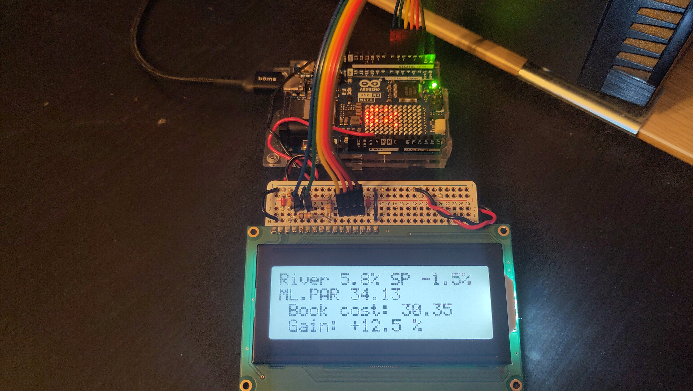
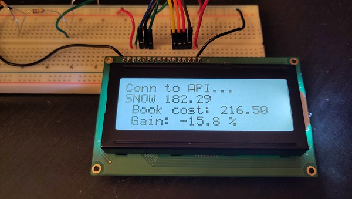
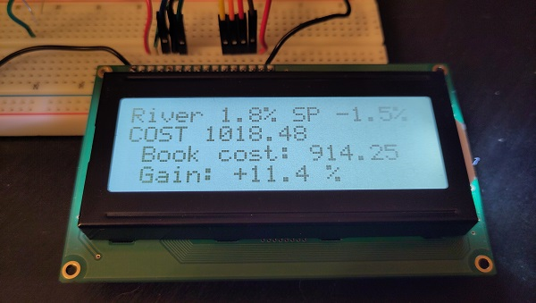
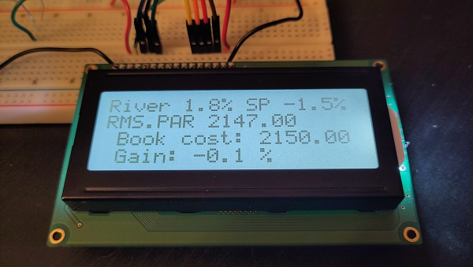
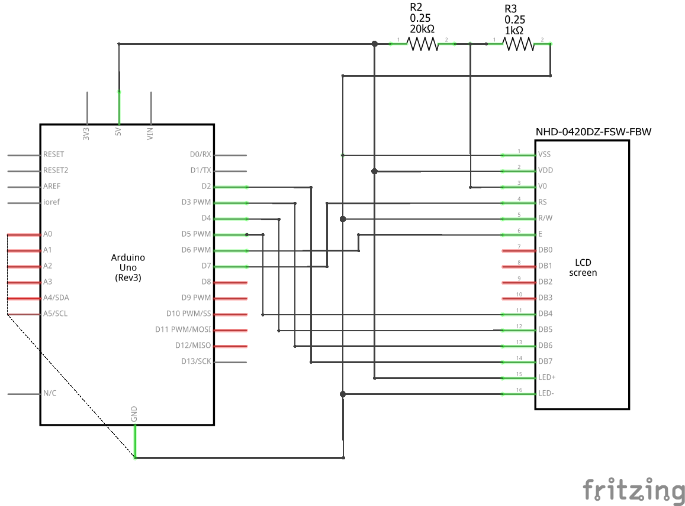

# Arduino Stocks
Stock portfolio monitoring on Arduino Uno R4 Wifi with an LCD display

Parts:
* Arduino Uno R4 Wifi
* LCD display: NHD-0420DZ-FSW-FBW - https://newhavendisplay.com/fr/content/specs/NHD-0420DZ-FSW-FBW.pdf

## Features
* Show a portfolio global gain percentage on the LCD screen and on the LED matrix
* Shows comparison with a chosen index (eg. S&P 500)
* Cycles through each stock every few seconds from the highest to lowest gain showing the stock code, book cost, current value, and gain %
* Updates every day from market data with API
* Supports weights for stocks (to account for a different level of investment in them to calculate global gain percentage)
* Not written with AI

## Pictures and Video
Video: https://www.youtube.com/shorts/Sd4D_UB64IQ

General overview:



Data loading phase:



Cycling through stocks once the data has been loaded:





## To make it work for you
You need to create a file called secrets.h in which you set:
```C
// The Wifi network name (SSID) to connect to
#define WIFI_NAME "your Wifi name"

// Wifi password
#define WIFI_PASSWORD "your Wifi password"

// To get stock market data
#define ALPHAVANTAGE_API_KEY "your API key"
```

Add your own stocks in my_stocks.ino and the price at which you bought them.

You can also adjust which ETF is used for comparison (as an approximation of S&P 500) which is displayed for comparison,
and you need to provide the price of this ETF so we can compare to its value now. It makes sense to provide
its price roughly at the moment when you bought your stocks.

Note that the list of stocks I provide only contain 3 stocks, it's obviously a bad idea to diversify that little
but I did not provide my actual complete list to avoid disclosing my own portfolio.

## Schematic

